# 📊 Business Insights & Recommendations Report
### Online Retail Analysis: 1 Dec 2009 – 9 Dec 2010

**Prepared by:** [Your Name]  |  **Tools:** Python, MySQL  |  **Data:** UCI Online Retail II (515,667 cleaned records)

---

## 1. Executive Summary

The business generated **£10.27M gross revenue** from **20,951 orders**, **4,312 identified customers** and **4,102 products** across **40 countries**, with an average order value of **£490**.

The data shows a healthy but **concentrated** business:

| Risk / Opportunity | Evidence |
|---|---|
| Depends on one market | UK = **85.8%** of revenue |
| Depends on few customers | Top 20% of customers = **73.6%** of revenue |
| Strongly seasonal | Sep–Nov = **34.5%** of revenue; November is **2.7×** February |
| Loyalty drives profit | Repeat customers = **94.4%** of revenue |
| Hidden revenue leakage | Credit notes = **£630K (6.13%)** of gross revenue |

**Bottom line:** growth will come less from finding many new buyers and more from **protecting key accounts, converting one-time buyers, preparing for Q4, and cutting return leakage.**

---

## 2. Business Overview (KPIs)

| KPI | Value |
|---|---|
| Gross revenue | £10,271,763 |
| Total credits (returns and credit notes) | £629,809 |
| **Net revenue** | **£9,641,954** |
| Units sold | 5,812,947 |
| Orders | 20,951 |
| Identified customers | 4,312 |
| Avg orders per customer | 4.46 |
| Avg spend per customer | £2,040 |
| Average order value | £490.28 |
| Period covered | 374 days |

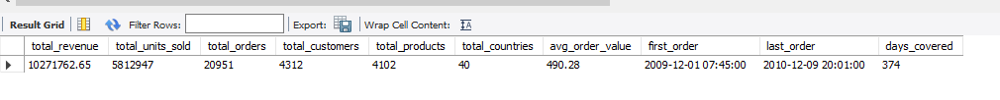 <em>SQL result A1: overall business size</em>

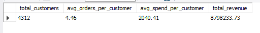 <em>SQL result C1: average orders and spend per customer</em>

---

## 3. Business Problems, Evidence and Solutions

### Problem 1: Revenue depends too heavily on the UK

**Evidence**

| Country | Revenue | Share | Orders | Customers | Avg order value |
|---|---|---|---|---|---|
| United Kingdom | £8,812,312 | 85.79% | 19,290 | 3,969 | £457 |
| EIRE | £380,910 | 3.71% | 348 | 5 | £1,095 |
| Netherlands | £268,784 | 2.62% | 135 | 22 | £1,991 |
| Germany | £202,025 | 1.97% | 347 | 67 | £582 |
| France | £147,103 | 1.43% | 241 | 47 | £610 |

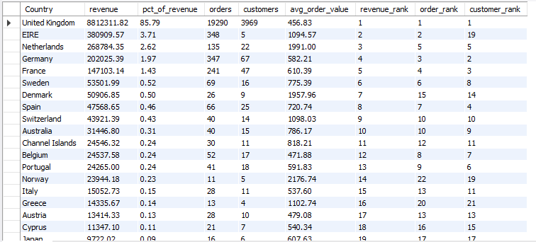 <em>SQL result D1: country performance and ranks</em>

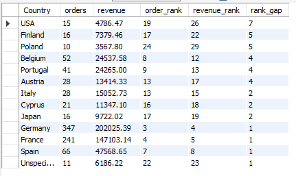 <em>SQL result D2: countries whose order rank beats revenue rank</em>

**Insights**
- Outside the UK, revenue is thin (14.2% combined) and spread across 39 countries.
- **EIRE and the Netherlands have very high order values** (£1,095 and £1,991 vs £457 in the UK) with very few customers. EIRE earns £381K from just **5 customers**. These are large wholesale accounts, not mass-market buyers.
- Some countries order often but with small baskets (USA, Finland, Poland, Belgium, Portugal, Austria, Italy: their order rank is better than their revenue rank, by up to 7 places).

**Recommended solutions**
1. Treat EIRE, Netherlands, Denmark and Norway as **high-value B2B markets**: assign account managers, offer export-friendly terms and free-shipping thresholds.
2. For low-basket markets, introduce **minimum order values or bundle offers** to lift the average order.
3. Set a target, for example **raise non-UK revenue from 14% to 20%** over the next year, and track it monthly.
4. Reduce risk: because 5 EIRE customers generate £381K, losing even one would be noticeable.

---

### Problem 2: A small group of customers carries the business

**Evidence**

| Segment (customers ranked by spend) | Customers | Revenue | Share |
|---|---|---|---|
| Top 20% (Segment 1) | 863 | £6,471,149 | **73.55%** |
| Segment 2 | 863 | £1,268,001 | 14.41% |
| Segment 3 | 862 | £615,556 | 7.00% |
| Segment 4 | 862 | £313,244 | 3.56% |
| Bottom 20% (Segment 5) | 862 | £130,283 | 1.48% |

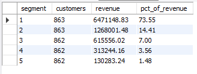 <em>SQL result C6: customers split into five revenue segments (80/20 analysis)</em>

- Customers spending **above the average** = 911 (21.1% of customers) → **74.7%** of revenue.
- Customers with **above-average spend AND above-average order frequency** = 757 (17.6%) → **68.3%** of revenue.
- The top 10 customers contribute **16.5%** of identified customer revenue. The #1 customer (ID 18102, UK) alone brings £349K (3.97%).
- Highest order frequency: customer 14911 (EIRE) placed **205 orders**, customer 17850 (UK) 155 orders.

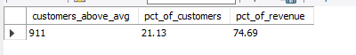 <em>SQL result C5: customers spending above average</em>

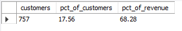 <em>SQL result F2: above-average spend and frequency</em>

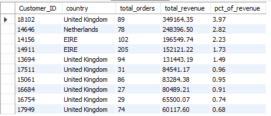 <em>SQL result C2: top 10 customers by revenue</em>

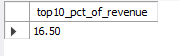 <em>SQL result C3: share of revenue from the top 10 customers</em>

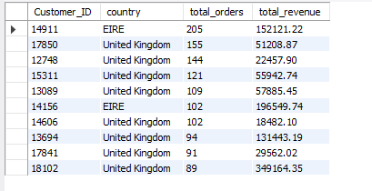 <em>SQL result C4: top 10 customers by number of orders</em>

**Insights**
- This is a classic **Pareto (80/20) pattern**. The bottom 40% of customers together give only ~5% of revenue.
- The best customers are both **big spenders and frequent buyers**, which means they depend on the business operationally (restocking).

**Recommended solutions**
1. Launch a **VIP / key-account programme** for the top 20% (863 customers): dedicated contact, priority stock, volume rebates, early previews.
2. Set up **early-warning alerts**: if a top-customer's order gap grows beyond their normal pattern, contact them immediately.
3. Don't spend marketing money equally. Focus retention budget on Segments 1–2 (≈88% of revenue).
4. For Segments 4–5, use low-cost automated emails only.

---

### Problem 3: Strong seasonality creates cash-flow and stock risk

**Evidence**

| Month | Revenue | Orders | MoM change |
|---|---|---|---|
| 2009-12 | £822,484 | 1,682 | – |
| 2010-01 | £651,155 | 1,105 | −20.8% |
| 2010-02 | **£551,505** (lowest full month) | 1,201 | −15.3% |
| 2010-03 | £830,915 | 1,681 | +50.7% |
| 2010-04 | £678,875 | 1,462 | −18.3% |
| 2010-05 | £657,706 | 1,500 | −3.1% |
| 2010-06 | £749,537 | 1,645 | +14.0% |
| 2010-07 | £648,810 | 1,529 | −13.4% |
| 2010-08 | £695,252 | 1,425 | +7.2% |
| 2010-09 | £921,697 | 1,839 | +32.6% |
| 2010-10 | £1,161,902 | 2,301 | +26.1% |
| **2010-11** | **£1,464,293** (peak) | **2,747** | +26.0% |
| 2010-12* | £437,631 | 834 | *partial month (to 9 Dec)* |

\* December 2010 has only 9 days of data. Its −70% change is **not** a real decline.

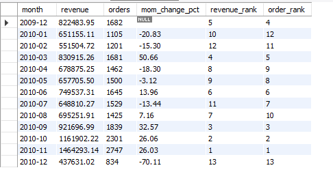 <em>SQL result A2: monthly revenue, orders, MoM change and ranks</em>

**Insights**
- Revenue climbs three months in a row from September to November (+32.6%, +26.1%, +26.0%).
- **Sep–Nov brings 34.5%** of annual revenue.
- The Feb–Aug period is flat at roughly £550K–£830K per month.
- Top-selling products include Christmas and party items (Paper Chain Kit 50's Christmas, Party Bunting), which supports the Q4 pattern.

**Recommended solutions**
1. **Start Q4 preparation in July–August**: confirm supplier capacity, increase stock of top sellers, hire temporary packing staff.
2. Run **early-bird B2B offers in August–September** so wholesale buyers order before the rush.
3. Use **February and the summer months** for clearance sales, new-product launches and customer-reactivation campaigns to flatten the curve.
4. Plan cash flow around the Q4 inventory spend, because the money for stock is needed before the revenue arrives.

---

### Problem 4: Sales are concentrated on weekdays (and Saturday is dead)

**Evidence**

| Day | Revenue | Orders |
|---|---|---|
| Thursday | £2,097,098 | 4,291 |
| Tuesday | £2,002,003 | 3,821 |
| Monday | £1,860,436 | 3,327 |
| Wednesday | £1,745,382 | 3,738 |
| Friday | £1,533,319 | 3,025 |
| Sunday | £1,023,721 | 2,719 |
| Saturday | £9,803 | **30** |

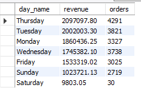 <em>SQL result A3: revenue and orders by day of week</em>

**Insights**
- Mon–Fri = **~90%** of revenue. Thursday and Tuesday together are ~40%.
- Almost no activity on Saturday suggests the business is **wholesale / B2B**, not consumer retail.
- Sunday is still meaningful (10% of revenue), so it is an under-used opportunity.

**Recommended solutions**
1. Schedule **email campaigns and promotions for Monday–Tuesday** so they land before the Thursday peak.
2. Make sure **customer service and dispatch capacity** peak on Tuesday–Thursday.
3. Test **Sunday-evening promotions** (businesses plan weekly orders then) and a **Friday "last order" push**, which is the weakest weekday.

---

### Problem 5: One-time customers don't come back

**Evidence**

| Customer type | Customers | % of customers | Revenue | % of revenue | Avg spend | Avg orders |
|---|---|---|---|---|---|---|
| Repeat | 2,893 | 67.09% | £8,301,929 | **94.36%** | £2,870 | 6.15 |
| One-time | 1,419 | 32.91% | £496,304 | 5.64% | £350 | 1.00 |

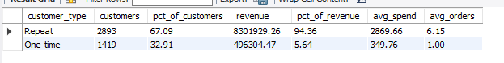 <em>SQL result F1: repeat vs one-time customers</em>

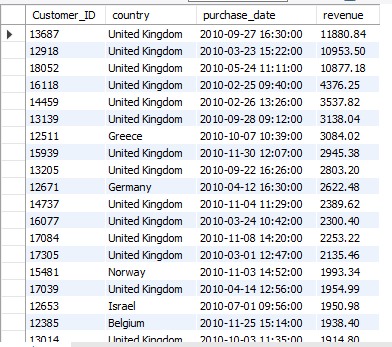 <em>SQL result F1: one-time customers sorted by spend</em>

**Monthly customer movement**

| Month | Active | New | Returning |
|---|---|---|---|
| 2010-01 | 720 | 383 | 337 |
| 2010-04 | 942 | 294 | 648 |
| 2010-08 | 911 | **162** | 749 |
| 2010-10 | 1,497 | 377 | 1,120 |
| 2010-11 | 1,607 | 325 | **1,282** |

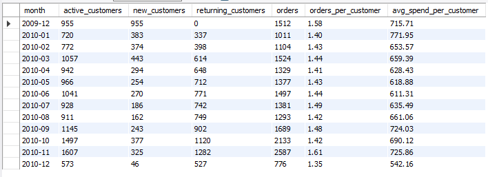 <em>SQL result F3: monthly new vs returning customers</em>

**Insights**
- A repeat customer is worth **8× more** than a one-time customer (£2,870 vs £350).
- New-customer acquisition **slowed in the middle of the year** (from 383 in January to 162 in August) and recovered only in the autumn.
- The Q4 peak is driven mainly by **returning customers** (1,282 returning vs 325 new in November), so retention matters more than acquisition.
- Some one-time buyers spent a lot (the biggest one-time order was £11,881), which suggests that these are **lost opportunities, not low-value customers**.

**Recommended solutions**
1. Create a **second-order journey**: thank-you email after the first order, then a time-limited incentive within 30 days.
2. **Follow up personally** on high-value one-time buyers (the list of one-time customers sorted by spend is in `07_customer_retention.sql`).
3. Run a **mid-year acquisition push** (May–August), when new customers dropped, using the clearance and new-range offers.
4. Track a monthly **repeat-purchase rate** as a headline KPI.

---

### Problem 6: Returns and credit notes leak revenue

**Evidence**

| Metric | Value |
|---|---|
| Return records / credit notes | 10,181 / 4,591 |
| Total credit value | £629,809 |
| of which: goods actually returned | £247,388 (39%) |
| of which: non-goods credits (manual/adjustment-type) | £382,421 (**61%**) |
| Credit as % of gross revenue | **6.13%** |
| Goods returns as % of gross revenue | **2.41%** |

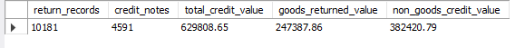 <em>SQL result E1: returns overview</em>

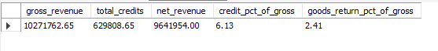 <em>SQL result E2: gross vs net revenue</em>

**Return rate by country** (return value ÷ product sales)

| Country | Return value | Sales | Return rate |
|---|---|---|---|
| United Kingdom | £195,622 | £8,452,924 | 2.31% |
| EIRE | £8,834 | £357,696 | 2.47% |
| Germany | £4,167 | £182,890 | 2.28% |
| France | £15,270 | £132,258 | **11.55%** |
| Spain | £8,995 | £42,855 | **20.99%** |
| Japan | £1,281 | £9,722 | 13.17% |
| Channel Islands | £2,118 | £24,346 | 8.70% |
| Denmark | £3,898 | £50,348 | 7.74% |

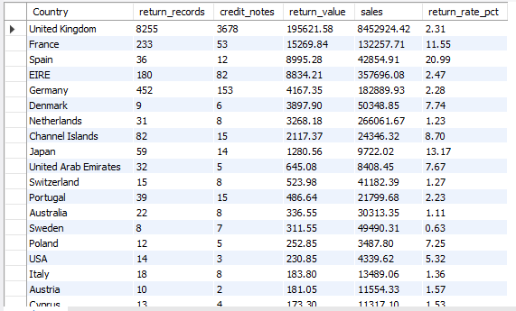 <em>SQL result E4: return activity and return rate by country</em>

**Products with the highest return value**

| Product | Returned value | Returned units |
|---|---|---|
| Regency Cakestand 3 Tier | £7,027 | 611 |
| White Cherry Lights | £6,367 | 1,080 |
| Pink Cherry Lights | £3,967 | 685 |
| Set/4 White Retro Storage Cubes | £3,939 | 112 |
| Baking Set 9 Piece Retrospot | £3,761 | 795 |

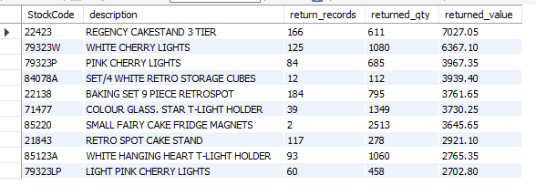 <em>SQL result E3: most returned products by value</em>

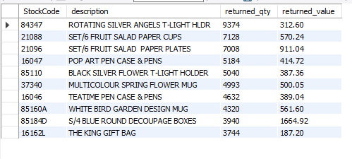 <em>SQL result E3: most returned products by quantity</em>

**Products with abnormal return rates** (≥100 units sold)

| Product | Sold | Returned | Return rate |
|---|---|---|---|
| Black Cherry Lights | 234 | 240 | **102.6%** (49 return records) |
| Roses on Blue Teacup Candle | 539 | 504 | 93.5% |
| Set of 6 Dots Chopsticks | 211 | 181 | 85.8% |
| La Palmiera Wall Thermometer | 438 | 372 | 84.9% |
| Porcelain Cherub Bell Small | 329 | 260 | 79.0% |
| Willow Branch Lights | 725 | 448 | 61.8% |

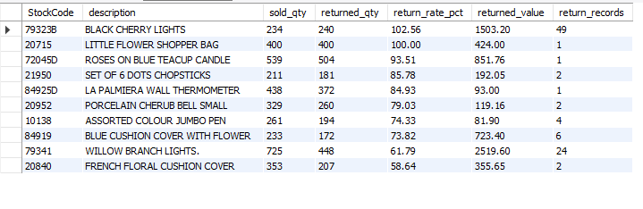 <em>SQL result E5: products with abnormal return rates</em>

**Insights**
- The overall goods-return rate (2.41%) is modest. The bigger issue is that **61% of credit value is not goods returns**, so the business needs to understand *why* those credits are issued (pricing errors, discounts, manual adjustments, postage refunds).
- **The "cherry lights" family** (white, pink, black, light pink) and **Willow Branch Lights** show up repeatedly in return lists. Lighting products may have a quality or description problem.
- Return rates above 100% mean returns exceed sales inside the window. Likely causes: items bought before December 2009 were returned later, or the same issue was credited several times. Either way, these items need checking.
- **France (11.55%) and Spain (20.99%)** have much higher return rates than the UK (2.31%). Spain's sales base is small, so it needs monitoring rather than panic.
- The top-revenue product (Regency Cakestand) is also the top-returned by value (~4% of its own revenue), likely because it is fragile ceramic and is shipped in volume.

**Recommended solutions**
1. **Audit the credit-note process.** Add a mandatory reason code (damaged, wrong item, pricing error, goodwill, postage) so the £382K of non-goods credits can be explained and reduced.
2. **Quality check the lighting range** (cherry lights, willow branch lights) with suppliers; consider delisting or reworking the worst items.
3. **Improve packaging for fragile items** (cake stands, ceramics, glass).
4. Investigate **France and Spain**: check carrier damage rates, product descriptions and language, delivery times.
5. Always report **both gross and net revenue** so that return leakage is visible to management.

---

### Problem 7: Product range: heroes, volume drivers and a long tail

**Evidence**

| Top by revenue | Revenue | Units |
|---|---|---|
| Regency Cakestand 3 Tier | £169,913 | 13,685 |
| White Hanging Heart T-Light Holder | £160,346 | 58,691 |
| Red Retrospot Jumbo Bag | £91,088 | 50,223 |
| Assorted Colour Bird Ornament | £72,890 | 45,228 |
| Paper Chain Kit 50's Christmas | £58,127 | 17,205 |

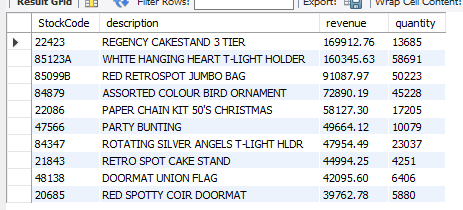 <em>SQL result B1: top 10 products by revenue</em>

| Top by quantity | Units | Revenue | Revenue per unit |
|---|---|---|---|
| Pack of 72 Retrospot Cake Cases | 60,076 | £31,702 | £0.53 |
| White Hanging Heart T-Light Holder | 58,691 | £160,346 | £2.73 |
| World War 2 Gliders Assorted | 54,947 | £11,384 | £0.21 |
| Red Retrospot Jumbo Bag | 50,223 | £91,088 | £1.81 |
| Brocade Ring Purse | 48,374 | £8,923 | £0.18 |

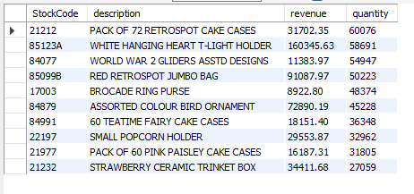 <em>SQL result B1: top 10 products by quantity</em>

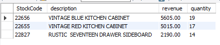 <em>SQL result B4: high-revenue, low-volume products</em>

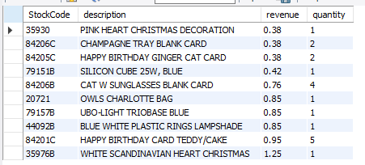 <em>SQL result B3: lowest-revenue products</em>

**Insights**
- The top 10 products bring only **~7.6%** of gross revenue, so the business is **not** dependent on a few products. It has a wide range (4,102 items).
- **Volume ≠ value:** WW2 Gliders and Brocade Ring Purses each sell ~50K units but earn only £0.18–£0.21 per unit, so they bring in little revenue relative to the packing and handling effort.
- **Premium niche items:** Vintage Blue/Red Kitchen Cabinets earn £5,000+ from just 17–19 units: high value per sale.
- The **long tail** includes items with under £1.25 total revenue (and 1–5 units sold), which add catalogue complexity without adding revenue.

**Recommended solutions**
1. **Protect the hero products** (Cakestand, T-Light Holder, Jumbo Bag): never go out of stock, especially before Q4.
2. **Bundle** low-price, high-volume items (cake cases, purses, gliders) into packs or use them as add-ons to lift basket value.
3. **Test higher prices** on volume items with very low unit prices.
4. **Promote premium niche furniture** to the right customers rather than discounting it.
5. **Rationalise the tail**: review products with almost no sales and delist or clear them.

---

## 4. Priority Action Plan

| Priority | Action | Expected impact | Effort |
|---|---|---|---|
| 🔴 High | VIP / key-account programme for top 20% customers | Protects ~74% of revenue | Medium |
| 🔴 High | Credit-note reason codes and audit (£382K non-goods credits) | Reduces leakage | Low |
| 🔴 High | Second-order campaign for one-time buyers | Raises repeat rate | Low |
| 🟠 Medium | Q4 stock and marketing plan starting July–August | Captures 35% peak season | Medium |
| 🟠 Medium | Non-UK growth plan (EIRE, NL, DK, NO) | Diversifies away from 86% UK share | Medium |
| 🟡 Normal | Quality review of lighting range and fragile items | Fewer returns | Medium |
| 🟡 Normal | Product bundles and tail rationalisation | Higher basket value, simpler catalogue | Low |
| 🟡 Normal | Day-of-week campaign timing | Better campaign results | Low |

## 5. KPIs to Track Going Forward

- Net revenue (gross minus credits) and credit % of gross
- Monthly repeat-purchase rate and new vs returning customers
- Share of revenue from the top 20% of customers
- UK vs non-UK revenue share
- Average order value by country
- Return rate by product and by country
- Q4 revenue vs prior year

## 6. Assumptions and Limitations

- The dataset covers **~12 months**, so seasonality is observed once and year-over-year growth is unknown.
- **December 2010 is incomplete** (data stops on 9 Dec).
- **December 2009 customers all show as "new"** because the data window begins there.
- **£1.47M (~14%) of gross revenue has no Customer ID** and is excluded from customer-level analysis.
- Product-level analysis excludes non-product codes (postage, manual entries, fees, test codes).
- Revenue is calculated as `Quantity × Price` with no cost data, so **profit margins cannot be measured**; recommendations are based on revenue and volume.
- Small-country return rates rely on small sales bases.
- Return explanations (quality issues, pre-period purchases) are **hypotheses** that need confirming with operational data.

## 7. Suggested Next Steps

1. Build a **dashboard** (Power BI / Tableau) with Sales, Customers, Countries and Returns pages.
2. Add **RFM segmentation** to turn the 80/20 finding into named customer groups.
3. Run **market-basket analysis** to find bundle opportunities.
4. Include cost data to analyse **profitability** instead of revenue only.

---

*Analysis performed with Python (Pandas) for cleaning and MySQL for analysis. All SQL queries are available in the `sql/` folder of this repository.*
